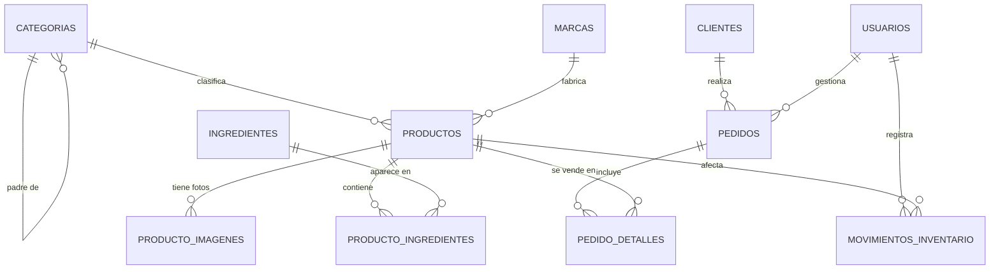

# Plan de diseño — Base de datos "Seoul Glow" (K-Beauty)

> **Caso:** Página web para una empresa utilizando Ubuntu 26 como servidor.
> **Alcance de este documento:** diseñar la base de datos MariaDB antes de escribir el código.
> **Marca de ejemplo:** *Seoul Glow* — tienda de productos coreanos de skincare (nombre provisional, se puede cambiar).
> **Base de datos:** `seoulglow_db` · **Motor:** InnoDB · **Charset:** `utf8mb4` / `utf8mb4_unicode_ci`

---

## 1. Contexto y alcance

La empresa vende productos de skincare coreano (limpiadores, tónicos, sérums, hidratantes, protectores solares, mascarillas, etc.) de distintas marcas (COSRX, Laneige, Beauty of Joseon, Anua, Torriden, Round Lab…).

La base de datos debe cubrir tres consumidores distintos:

| Consumidor | Dónde corre | Qué necesita |
|---|---|---|
| Página web (catálogo) | Ubuntu 26 (Apache + Next.js) | **Solo lectura**: productos activos, marca, categoría, precio, stock disponible, imágenes, ingredientes destacados |
| Aplicación de escritorio (Apache NetBeans) | Windows | **CRUD completo**: productos, marcas, categorías, clientes, pedidos, inventario, usuarios |
| DBeaver | Windows | Administración y consultas (con un usuario administrador, no `root`) |

### Qué entra en la Fase 1 (obligatoria)

- Catálogo: categorías, marcas, productos, imágenes, ingredientes.
- Ventas: clientes, pedidos, detalle de pedidos.
- Operación: usuarios del sistema y movimientos de inventario (kardex).
- Vistas para la web, permisos separados web/admin y datos de ejemplo.

### Qué queda para la Fase 2 (opcional, si sobra tiempo)

Proveedores y compras, reseñas de clientes, cupones/descuentos, lista de deseos, etiquetas ("vegano", "cruelty-free"), multi-moneda con tipo de cambio, auditoría completa.

> **Por qué incluir pedidos si la web solo "muestra productos":** la app de NetBeans debe *gestionar* la base de datos y en la exposición se ve mucho mejor poder registrar una venta y ver el stock bajar. El catálogo web usa solo 6 tablas; el resto le da sentido al sistema.

---

## 2. Decisiones de diseño

| Tema | Decisión | Motivo |
|---|---|---|
| Motor | InnoDB | Transacciones, claves foráneas, bloqueo por fila |
| Charset | `utf8mb4` + `utf8mb4_unicode_ci` | Nombres coreanos, emojis, tildes y símbolos (ㄴ, ㅎ, ✨) sin romper nada |
| Nombres | Tablas en singular y español, `snake_case`, PK `id_<tabla>` | Consistencia y lectura fácil en la exposición |
| PK | `BIGINT UNSIGNED AUTO_INCREMENT` (catálogos pequeños pueden usar `INT UNSIGNED`) | Espacio de sobra, sin costo real |
| Dinero | `DECIMAL(12,2)` + columna `moneda CHAR(3)` | Nunca `FLOAT`/`DOUBLE` para precios |
| Fechas | `DATETIME` con `DEFAULT CURRENT_TIMESTAMP`, `updated_at ... ON UPDATE` | Trazabilidad mínima |
| Booleanos | `TINYINT(1)` con `DEFAULT 0/1` | Estándar en MariaDB/MySQL |
| Estados | `ENUM` para `estado`, `rol`, `tipo_movimiento` | Simple y suficiente; documentado como decisión consciente |
| Borrado | Lógico (`activo = 0`) en catálogo; físico solo en tablas hijas | No perder historial de pedidos |
| Normalización | 3FN | Sin datos repetidos; el precio del pedido se guarda como *snapshot* a propósito |
| Zona horaria | Guardar en UTC y mostrar en la app | Evita líos al exponer |

**Regla de oro del precio:** `pedido_detalles.precio_unitario` copia el precio del momento de la venta. Si mañana el producto sube de precio, el pedido histórico no cambia.

---

## 3. Modelo entidad-relación



### Cardinalidades

| Relación | Cardinalidad | Regla |
|---|---|---|
| categoría → productos | 1 : N | Un producto pertenece a **una** categoría |
| categoría → categoría | 1 : N | Subcategorías opcionales (auto-referencia) |
| marca → productos | 1 : N | Un producto tiene **una** marca |
| producto → imágenes | 1 : N | Solo una marcada como principal |
| producto ↔ ingredientes | N : M | Tabla puente con `es_clave` y `porcentaje` |
| cliente → pedidos | 1 : N | Un cliente puede no tener pedidos |
| pedido → detalles | 1 : N | `ON DELETE CASCADE` |
| producto → detalles | 1 : N | `ON DELETE RESTRICT` (no borrar producto vendido) |
| usuario → pedidos | 1 : N | Vendedor que registró el pedido (nullable) |

---

## 4. Diccionario de datos

### 4.1 `categorias`

| Columna | Tipo | Nulo | Default | Descripción |
|---|---|---|---|---|
| `id_categoria` | INT UNSIGNED PK AI | No | — | Identificador |
| `nombre` | VARCHAR(80) UNIQUE | No | — | "Sérums", "Protectores solares" |
| `slug` | VARCHAR(100) UNIQUE | No | — | URL amigable: `serums`, `protectores-solares` |
| `descripcion` | VARCHAR(255) | Sí | NULL | Texto corto para la web |
| `id_padre` | INT UNSIGNED FK → `categorias` | Sí | NULL | Subcategoría |
| `activa` | TINYINT(1) | No | 1 | Ocultar sin borrar |
| `created_at` / `updated_at` | DATETIME | No | CURRENT_TIMESTAMP | Auditoría |

Índices: `idx_categorias_padre (id_padre)`.

### 4.2 `marcas`

| Columna | Tipo | Nulo | Default | Descripción |
|---|---|---|---|---|
| `id_marca` | INT UNSIGNED PK AI | No | — | Identificador |
| `nombre` | VARCHAR(80) UNIQUE | No | — | COSRX, Laneige… |
| `pais_origen` | VARCHAR(60) | No | 'Corea del Sur' | Procedencia |
| `sitio_web` | VARCHAR(200) | Sí | NULL | Enlace oficial |
| `logo_url` | VARCHAR(500) | Sí | NULL | Imagen del logo |
| `descripcion` | TEXT | Sí | NULL | Historia de la marca |
| `activa` | TINYINT(1) | No | 1 | — |
| `created_at` / `updated_at` | DATETIME | No | CURRENT_TIMESTAMP | — |

### 4.3 `productos` (tabla central)

| Columna | Tipo | Nulo | Default | Descripción |
|---|---|---|---|---|
| `id_producto` | BIGINT UNSIGNED PK AI | No | — | Identificador |
| `sku` | VARCHAR(40) UNIQUE | No | — | Código interno: `COS-RS-001` |
| `nombre` | VARCHAR(150) | No | — | "Relief Sun Rice + Probiotics SPF50+" |
| `slug` | VARCHAR(180) UNIQUE | No | — | URL del producto en la web |
| `descripcion_corta` | VARCHAR(255) | Sí | NULL | Para la tarjeta del catálogo |
| `descripcion` | TEXT | Sí | NULL | Ficha completa |
| `id_marca` | INT UNSIGNED FK | No | — | `ON DELETE RESTRICT` |
| `id_categoria` | INT UNSIGNED FK | No | — | `ON DELETE RESTRICT` |
| `precio` | DECIMAL(12,2) | No | — | Precio de lista, `CHECK (precio >= 0)` |
| `precio_oferta` | DECIMAL(12,2) | Sí | NULL | `CHECK (precio_oferta > 0 AND precio_oferta < precio)` |
| `moneda` | CHAR(3) | No | 'USD' | ISO 4217 |
| `stock` | INT | No | 0 | `CHECK (stock >= 0)` |
| `stock_minimo` | INT | No | 5 | Dispara alerta de reposición |
| `volumen_ml` | SMALLINT UNSIGNED | Sí | NULL | 30, 50, 100, 150… |
| `tipo_piel` | SET('grasa','seca','mixta','sensible','normal') | Sí | NULL | Filtro de la web |
| `activo` | TINYINT(1) | No | 1 | Borrado lógico |
| `destacado` | TINYINT(1) | No | 0 | Carrusel de la home |
| `created_at` / `updated_at` | DATETIME | No | CURRENT_TIMESTAMP | — |

Índices:
- `idx_productos_categoria (id_categoria, activo)`
- `idx_productos_marca (id_marca, activo)`
- `idx_productos_precio (precio)`
- `ft_productos (nombre, descripcion_corta)` → `FULLTEXT` para el buscador de la web.

### 4.4 `producto_imagenes`

| Columna | Tipo | Nulo | Default | Descripción |
|---|---|---|---|---|
| `id_imagen` | BIGINT UNSIGNED PK AI | No | — | — |
| `id_producto` | BIGINT UNSIGNED FK | No | — | `ON DELETE CASCADE` |
| `url` | VARCHAR(500) | No | — | Ruta relativa o URL |
| `alt_text` | VARCHAR(150) | Sí | NULL | Accesibilidad/SEO |
| `orden` | TINYINT UNSIGNED | No | 0 | Orden en la galería |
| `es_principal` | TINYINT(1) | No | 0 | Una por producto (regla en la app) |

### 4.5 `ingredientes`

| Columna | Tipo | Nulo | Default | Descripción |
|---|---|---|---|---|
| `id_ingrediente` | INT UNSIGNED PK AI | No | — | — |
| `nombre` | VARCHAR(100) UNIQUE | No | — | "Centella asiática", "Niacinamida" |
| `beneficio` | VARCHAR(150) | Sí | NULL | "Calmante", "Iluminador" |
| `descripcion` | TEXT | Sí | NULL | Explicación para la ficha |
| `es_activo` | TINYINT(1) | No | 1 | Ingrediente "estrella" |

### 4.6 `producto_ingredientes` (puente N:M)

| Columna | Tipo | Nulo | Default | Descripción |
|---|---|---|---|---|
| `id_producto` | BIGINT UNSIGNED FK | No | — | PK compuesta |
| `id_ingrediente` | INT UNSIGNED FK | No | — | PK compuesta |
| `porcentaje` | DECIMAL(5,2) | Sí | NULL | Solo si la marca lo publica |
| `es_clave` | TINYINT(1) | No | 0 | Se muestra en la web |

PK `(id_producto, id_ingrediente)` · ambos FK `ON DELETE CASCADE`.

### 4.7 `clientes`

| Columna | Tipo | Nulo | Default | Descripción |
|---|---|---|---|---|
| `id_cliente` | BIGINT UNSIGNED PK AI | No | — | — |
| `nombre` | VARCHAR(80) | No | — | — |
| `apellido` | VARCHAR(80) | No | — | — |
| `email` | VARCHAR(150) UNIQUE | No | — | Login/contacto |
| `telefono` | VARCHAR(30) | Sí | NULL | — |
| `direccion` | VARCHAR(200) | Sí | NULL | Fase 1 simplificada |
| `ciudad` | VARCHAR(80) | Sí | NULL | — |
| `pais` | VARCHAR(60) | No | 'Ecuador' | Ajustar al país del curso |
| `fecha_nacimiento` | DATE | Sí | NULL | Campañas de cumpleaños |
| `acepta_marketing` | TINYINT(1) | No | 0 | Consentimiento |
| `activo` | TINYINT(1) | No | 1 | — |
| `created_at` / `updated_at` | DATETIME | No | CURRENT_TIMESTAMP | — |

Índice: `idx_clientes_nombre (apellido, nombre)`.

> Si el proyecto crece: mover direcciones a `direcciones_cliente` (1:N) para envíos múltiples.

### 4.8 `pedidos`

| Columna | Tipo | Nulo | Default | Descripción |
|---|---|---|---|---|
| `id_pedido` | BIGINT UNSIGNED PK AI | No | — | — |
| `numero_pedido` | VARCHAR(20) UNIQUE | No | — | `PED-2026-000123` (generado por la app/procedimiento) |
| `id_cliente` | BIGINT UNSIGNED FK | No | — | `ON DELETE RESTRICT` |
| `id_usuario` | BIGINT UNSIGNED FK | Sí | NULL | Vendedor que lo registró |
| `fecha_pedido` | DATETIME | No | CURRENT_TIMESTAMP | — |
| `estado` | ENUM('pendiente','pagado','en_preparacion','enviado','entregado','cancelado') | No | 'pendiente' | Flujo de la venta |
| `metodo_pago` | ENUM('tarjeta','transferencia','efectivo','paypal') | Sí | NULL | — |
| `subtotal` | DECIMAL(12,2) | No | 0.00 | Suma de líneas |
| `descuento` | DECIMAL(12,2) | No | 0.00 | Descuento global |
| `impuesto` | DECIMAL(12,2) | No | 0.00 | IVA si aplica |
| `total` | DECIMAL(12,2) | No | 0.00 | `subtotal - descuento + impuesto` |
| `notas` | VARCHAR(255) | Sí | NULL | — |
| `created_at` / `updated_at` | DATETIME | No | CURRENT_TIMESTAMP | — |

Índices: `idx_pedidos_cliente (id_cliente, fecha_pedido)`, `idx_pedidos_estado (estado, fecha_pedido)`.

### 4.9 `pedido_detalles`

| Columna | Tipo | Nulo | Default | Descripción |
|---|---|---|---|---|
| `id_detalle` | BIGINT UNSIGNED PK AI | No | — | — |
| `id_pedido` | BIGINT UNSIGNED FK | No | — | `ON DELETE CASCADE` |
| `id_producto` | BIGINT UNSIGNED FK | No | — | `ON DELETE RESTRICT` |
| `cantidad` | SMALLINT UNSIGNED | No | — | `CHECK (cantidad > 0)` |
| `precio_unitario` | DECIMAL(12,2) | No | — | Snapshot del precio |
| `descuento_linea` | DECIMAL(12,2) | No | 0.00 | — |
| `subtotal_linea` | DECIMAL(12,2) GENERATED | — | — | `cantidad * precio_unitario - descuento_linea` (STORED) |

Restricción: `UNIQUE (id_pedido, id_producto)` → un producto aparece una sola vez por pedido (si se repite, se suma la cantidad).

### 4.10 `usuarios` (personal / app de escritorio)

| Columna | Tipo | Nulo | Default | Descripción |
|---|---|---|---|---|
| `id_usuario` | INT UNSIGNED PK AI | No | — | — |
| `nombre_completo` | VARCHAR(120) | No | — | — |
| `usuario` | VARCHAR(50) UNIQUE | No | — | Login |
| `email` | VARCHAR(150) UNIQUE | No | — | — |
| `password_hash` | VARCHAR(255) | No | — | **bcrypt/Argon2**, nunca texto plano |
| `rol` | ENUM('admin','gerente','vendedor','soporte') | No | 'vendedor' | Permisos de la app |
| `activo` | TINYINT(1) | No | 1 | — |
| `ultimo_acceso` | DATETIME | Sí | NULL | — |
| `created_at` / `updated_at` | DATETIME | No | CURRENT_TIMESTAMP | — |

### 4.11 `movimientos_inventario` (kardex)

| Columna | Tipo | Nulo | Default | Descripción |
|---|---|---|---|---|
| `id_movimiento` | BIGINT UNSIGNED PK AI | No | — | — |
| `id_producto` | BIGINT UNSIGNED FK | No | — | — |
| `tipo` | ENUM('entrada','salida','ajuste','devolucion') | No | — | — |
| `cantidad` | INT | No | — | Positiva; el signo lo da `tipo` |
| `motivo` | VARCHAR(150) | Sí | NULL | "Venta PED-2026-000123", "Reposición" |
| `id_usuario` | INT UNSIGNED FK | Sí | NULL | Quién lo registró |
| `stock_resultante` | INT | No | — | Stock después del movimiento |
| `created_at` | DATETIME | No | CURRENT_TIMESTAMP | — |

Índices: `idx_mov_producto (id_producto, created_at)`, `idx_mov_tipo (tipo, created_at)`.

---

## 5. Reglas de integridad (dónde vive cada validación)

| Regla | Dónde se implementa |
|---|---|
| `stock >= 0`, `precio > 0`, `cantidad > 0` | `CHECK` en la tabla (última línea de defensa) |
| `precio_oferta < precio` | `CHECK` |
| No vender más que el stock | Procedimiento `sp_registrar_pedido` con `SELECT ... FOR UPDATE` |
| Stock baja al vender y queda registrado | Trigger `tr_detalle_after_insert` (o el procedimiento, ver §6) |
| Total del pedido coherente | `sp_recalcular_total_pedido` |
| Solo una imagen principal | App de NetBeans (transacción: `UPDATE ... SET es_principal = 0` y luego `= 1`) |
| Email/SKU/numero_pedido únicos | `UNIQUE` |
| No borrar productos/marcas con ventas | `ON DELETE RESTRICT` |

---

## 6. Vistas, procedimientos y triggers

### Vistas (la web solo ve estas)

```sql
-- Catálogo listo para la página web
CREATE OR REPLACE VIEW v_catalogo_web AS
SELECT p.id_producto, p.sku, p.nombre, p.slug,
       p.descripcion_corta,
       m.nombre  AS marca,
       c.nombre  AS categoria,
       c.slug    AS categoria_slug,
       COALESCE(p.precio_oferta, p.precio) AS precio_efectivo,
       p.precio, p.precio_oferta, p.moneda,
       p.stock, p.volumen_ml, p.tipo_piel, p.destacado,
       (SELECT i.url FROM producto_imagenes i
         WHERE i.id_producto = p.id_producto
         ORDER BY i.es_principal DESC, i.orden ASC LIMIT 1) AS imagen_principal
FROM productos p
JOIN marcas m     ON m.id_marca = p.id_marca
JOIN categorias c ON c.id_categoria = p.id_categoria
WHERE p.activo = 1 AND m.activa = 1 AND c.activa = 1;

-- Alerta de reposición para la app de escritorio
CREATE OR REPLACE VIEW v_stock_bajo AS
SELECT id_producto, sku, nombre, stock, stock_minimo
FROM productos
WHERE activo = 1 AND stock <= stock_minimo;

-- Resumen de ventas por mes
CREATE OR REPLACE VIEW v_ventas_mensuales AS
SELECT DATE_FORMAT(fecha_pedido, '%Y-%m') AS periodo,
       COUNT(*) AS pedidos,
       SUM(total) AS ingresos
FROM pedidos
WHERE estado NOT IN ('cancelado','pendiente')
GROUP BY periodo;
```

### Procedimientos

- `sp_registrar_pedido(id_cliente, id_usuario, JSON items)` → crea pedido, valida stock, inserta detalles, descuenta inventario y calcula totales en **una transacción**.
- `sp_reponer_stock(id_producto, cantidad, id_usuario, motivo)` → entrada de inventario + actualiza `productos.stock`.
- `sp_recalcular_total_pedido(id_pedido)` → recalcula subtotal/total tras cambios.

### Triggers

- `tr_detalle_after_insert` → descuenta `productos.stock` + inserta la salida en `movimientos_inventario`.
- `tr_detalle_after_delete` → devuelve el stock de esa línea (ajustes manuales).

> **Decisión:** el trigger es el **único** punto que modifica stock por ventas. Si el procedimiento también lo hiciera, se descontaría dos veces. `sp_registrar_pedido` valida el stock dentro de la transacción y luego inserta las líneas; el trigger aplica el descuento y registra el kardex. `sp_cancelar_pedido` devuelve el stock explícitamente y deja las líneas como historial (no las borra, para no duplicar la devolución).

---

## 7. Seguridad y usuarios de MariaDB

**Nunca usar `root` desde Windows.** Se crean tres usuarios:

```sql
-- 1) Web: SOLO lectura. Next.js corre en la misma VM, así que entra por localhost
--    (no necesita acceso remoto: menos superficie de ataque)
CREATE USER 'web_skincare'@'localhost' IDENTIFIED BY 'WebSkincare2026!';
GRANT SELECT ON seoulglow_db.v_catalogo_web TO 'web_skincare'@'localhost';
GRANT SELECT ON seoulglow_db.producto_imagenes TO 'web_skincare'@'localhost';
GRANT SELECT ON seoulglow_db.producto_ingredientes TO 'web_skincare'@'localhost';
GRANT SELECT ON seoulglow_db.ingredientes TO 'web_skincare'@'localhost';

-- 2) App de escritorio / DBeaver: CRUD completo sobre la base
CREATE USER 'admin_skincare'@'192.168.56.%' IDENTIFIED BY 'AdminSkincare2026!';
GRANT SELECT, INSERT, UPDATE, DELETE, EXECUTE
  ON seoulglow_db.* TO 'admin_skincare'@'192.168.56.%';

-- 3) Respaldo (opcional)
CREATE USER 'backup_skincare'@'localhost' IDENTIFIED BY 'BackupSkincare2026!';
GRANT SELECT, LOCK TABLES, SHOW VIEW, EVENT, TRIGGER ON seoulglow_db.* TO 'backup_skincare'@'localhost';

FLUSH PRIVILEGES;
```

### Conectividad Windows → Ubuntu (esto es lo que suele fallar)

1. **Red de la VM:** usar **Host-only** o **Bridged**. Con NAT simple, Windows no alcanza la VM.
2. **Escuchar en la red** — `/etc/mysql/mariadb.conf.d/50-server.cnf`:
   ```ini
   bind-address = 0.0.0.0
   # opcional: port = 3306
   ```
3. **Firewall** — solo la red del laboratorio:
   ```bash
   sudo ufw allow from 192.168.56.0/24 to any port 3306 proto tcp
   ```
4. **Reiniciar y verificar:**
   ```bash
   sudo systemctl restart mariadb
   ss -tlnp | grep 3306
   ```
5. **Prueba desde Windows (PowerShell):**
   ```powershell
   Test-NetConnection 192.168.56.10 -Port 3306
   ```
6. **DBeaver:** conexión ya creada → solo cambiar usuario a `admin_skincare` y marcar *"Allow public key retrieval"* si aparece el error de autenticación.

### Configuración de conexión (para NetBeans / DBeaver / Next.js)

| Parámetro | Valor |
|---|---|
| Host (desde Windows) | IP de la VM Ubuntu (ej. `192.168.56.10`) |
| Host (desde la web en la VM) | `127.0.0.1` |
| Puerto | `3306` |
| Base de datos | `seoulglow_db` |
| Usuario app | `admin_skincare` |
| Usuario web | `web_skincare` |
| Driver Java | MariaDB Connector/J (`org.mariadb.jdbc.Driver`) |
| URL JDBC | `jdbc:mariadb://192.168.56.10:3306/seoulglow_db` |
| Next.js (`mysql2`) | `{ host: '127.0.0.1', database: 'seoulglow_db', user: 'web_skincare' }` |

> Guardar credenciales fuera del código: `.env.local` con permisos `600` en Ubuntu y un `db.properties` en el proyecto Java.

---

## 8. Datos de ejemplo (semilla)

Volumen sugerido para que la demo se vea real:

| Tabla | Registros |
|---|---|
| `categorias` | 9 (+3 subcategorías) |
| `marcas` | 10 |
| `productos` | 30–40 |
| `producto_imagenes` | 2–3 por producto |
| `ingredientes` | 12 |
| `producto_ingredientes` | 60–80 |
| `clientes` | 15 |
| `pedidos` | 20 en distintos estados |
| `pedido_detalles` | 50 |
| `usuarios` | 4 (1 por rol) |
| `movimientos_inventario` | 40 |

**Categorías:** Limpiadores · Tónicos · Esencias y sérums · Hidratantes · Protectores solares · Mascarillas · Contorno de ojos · Exfoliantes · Kits.

**Marcas:** COSRX, Laneige, Innisfree, Beauty of Joseon, Anua, Torriden, Round Lab, Some By Mi, Dr. Jart+, Sulwhasoo.

**Ingredientes:** Centella asiática, Niacinamida, Ácido hialurónico, Mucina de caracol, Té verde, Extracto de arroz, Ceramidas, Vitamina C, Retinol, Pantenol, Heartleaf (*Houttuynia cordata*), Probióticos.

**Productos de ejemplo:**
- COSRX — Advanced Snail 96 Mucin Power Essence (100 ml)
- COSRX — Low pH Good Morning Gel Cleanser (150 ml)
- Beauty of Joseon — Relief Sun Rice + Probiotics SPF50+ (50 ml)
- Anua — Heartleaf 77% Soothing Toner (250 ml)
- Torriden — Dive-In Low Molecule Hyaluronic Acid Serum (50 ml)
- Laneige — Water Sleeping Mask (70 ml)
- Round Lab — 1025 Dokdo Toner (200 ml)
- Some By Mi — AHA BHA PHA 30 Days Miracle Toner (150 ml)

> Los nombres de marcas se usan solo con fines académicos; en la exposición aclarar que es un caso de estudio.

---

## 9. Cómo consume la base cada componente

### 9.1 Decisión de stack para la web: **Next.js (elegida por el equipo)**

**Primero, lo que no cambia: HTML + CSS + JS en el navegador NO alcanza.**
El navegador no puede hablar el protocolo de MariaDB y, aunque pudiera, habría que
exponer el usuario y la contraseña en el JavaScript (cualquiera los ve con `F12`).
La conexión a la base **siempre** va del lado del servidor. La decisión es *con qué*
backend.

| Opción | Qué implica | Veredicto |
|---|---|---|
| Apache + PHP + HTML/CSS/JS | `apt install php php-mysql`; PDO devuelve HTML | La más simple, pero no fue la elegida |
| **Next.js (React) + Apache como proxy** | Node + build + `systemd` + `ProxyPass` | ✅ **Elegida**: mejor presentación, SEO, componentes reutilizables |
| Node.js + Express + HTML/JS | API propia + proxy | Intermedio, sin las ventajas de Next.js |
| HTML estático + JSON exportado | No consulta la base en vivo | ❌ No cumple el punto 4 |

**Por qué se justifica Next.js aquí:** la ficha de producto necesita SEO real
(`generateMetadata`), el catálogo se renderiza en el servidor con datos de MariaDB,
y los filtros se resuelven con `searchParams` sin escribir una API aparte. El costo
es un proceso Node más, un `next build` y la configuración de Apache; se asume
conscientemente y se documenta en `PLAN_WEB_NEXTJS.md`.

**Arquitectura:**

```
Navegador (React en el cliente)
        │  HTTP :80
        ▼
Apache 2.4  ──proxy──▶  Next.js (Node) 127.0.0.1:3000
                              │  mysql2 / pool
                              ▼
                        MariaDB  →  web_skincare@localhost (solo SELECT)
```

- Apache **no** consulta la base: solo hace de reverse proxy.
- Next.js corre en la misma VM, por eso el usuario web es `@'localhost'`.
- La app de NetBeans y DBeaver siguen entrando desde Windows por `3306`.

> Regla para la exposición: *"el frontend pide la página, Next.js la arma en el
> servidor consultando MariaDB, y el navegador nunca ve las credenciales"*.

### Página web (Next.js + `mysql2`, solo lectura)

```ts
// lib/db.ts — corre únicamente en el servidor
export const pool = mysql.createPool({
  host: process.env.DB_HOST,        // 127.0.0.1
  user: process.env.DB_USER,        // web_skincare
  password: process.env.DB_PASSWORD,
  database: process.env.DB_NAME,    // seoulglow_db
  charset: 'utf8mb4',
  decimalNumbers: true,
});
```

- El catálogo **no** consulta `productos` directamente: usa `v_catalogo_web`, así se puede cambiar el esquema sin tocar la UI.
- La web nunca hace `INSERT/UPDATE/DELETE` (lo garantiza el `GRANT`).
- Detalle completo (rutas, Apache, systemd, pruebas): `PLAN_WEB_NEXTJS.md`.

### Aplicación de escritorio (Java Swing/JavaFX + JDBC)

- `org.mariadb.jdbc.Driver` + `DriverManager.getConnection(...)`.
- Patrón DAO por tabla: `ProductoDAO`, `PedidoDAO`, `ClienteDAO`.
- Formularios: productos (con combo de marca/categoría), pedidos (cabecera + tabla de detalles), inventario, usuarios.
- Las operaciones de venta llaman a `CALL sp_registrar_pedido(...)`; el resto usa `PreparedStatement`.

---

## 10. Orden de ejecución y entregables

### Scripts SQL (ya generados en `sql/`)

```
sql/
├── README.md          -- orden de ejecución, credenciales y consultas de prueba
├── 01_schema.sql      -- CREATE DATABASE, tablas, FKs, índices, CHECK
├── 02_seed.sql        -- categorías, marcas, productos, ingredientes, clientes, pedidos
├── 03_views.sql       -- v_catalogo_web, v_stock_bajo, v_ventas_mensuales
├── 04_routines.sql    -- procedimientos y triggers
└── 05_users.sql       -- usuarios y GRANTs (web_skincare, admin_skincare)
```

Ejecutar **en ese orden** desde DBeaver con `Alt+X` (script completo, no sentencia por sentencia).
Detalles, credenciales y pruebas en `sql/README.md`.

### Checklist contra los 5 puntos del caso

| # | Requisito | Estado | Evidencia para la exposición |
|---|---|---|---|
| 1 | Ubuntu 26 en VM | ✅ hecho | Captura de `lsb_release -a` |
| 2 | MariaDB instalado | ✅ hecho | `systemctl status mariadb` |
| 2b | Base de datos creada desde Windows con DBeaver | ⬜ pendiente | Captura de DBeaver con las 11 tablas y el diagrama ER |
| 3 | Servidor web instalado | ✅ hecho | `curl http://localhost` |
| 4 | Página web que muestra productos desde MariaDB | ⬜ pendiente | Catálogo + ficha de producto + buscador |
| 5 | App de escritorio en NetBeans para gestionar la BD | ⬜ pendiente | CRUD de productos + registrar pedido + alerta de stock |

### Plan de trabajo sugerido

| Fase | Tarea | Tiempo estimado |
|---|---|---|
| A | Ejecutar `01_schema.sql` y verificar en DBeaver | 1 h |
| B | Cargar `02_seed.sql` y revisar datos | 30 min |
| C | Crear vistas, procedimientos, triggers y usuarios | 1 h |
| D | Probar consultas de la web y del kardex | 30 min |
| E | Página web (catálogo + ficha + buscador) | 4–6 h |
| F | App NetBeans (CRUD + pedidos + reportes) | 6–8 h |
| G | Pruebas de conexión desde Windows y ensayo de exposición | 1 h |

---

## 11. Pruebas de verificación (para la demo)

```sql
-- 1. ¿Cuántos productos activos hay por categoría?
SELECT c.nombre, COUNT(*) AS productos
FROM productos p JOIN categorias c ON c.id_categoria = p.id_categoria
WHERE p.activo = 1 GROUP BY c.nombre ORDER BY productos DESC;

-- 2. Top 5 más vendidos
SELECT p.nombre, SUM(d.cantidad) AS unidades
FROM pedido_detalles d JOIN productos p ON p.id_producto = d.id_producto
GROUP BY p.id_producto ORDER BY unidades DESC LIMIT 5;

-- 3. Productos por reponer
SELECT * FROM v_stock_bajo;

-- 4. Ingredientes clave de un producto
SELECT i.nombre, pi.porcentaje
FROM producto_ingredientes pi JOIN ingredientes i USING (id_ingrediente)
WHERE pi.id_producto = 1 AND pi.es_clave = 1;

-- 5. Verificar que el stock del producto coincide con el kardex
SELECT p.id_producto, p.stock,
       SUM(CASE WHEN m.tipo IN ('entrada','devolucion') THEN m.cantidad
                WHEN m.tipo = 'salida' THEN -m.cantidad ELSE 0 END) AS segun_kardex
FROM productos p LEFT JOIN movimientos_inventario m USING (id_producto)
GROUP BY p.id_producto;
```

---

## 12. Decisiones abiertas (confirmar antes de generar el SQL)

1. **País/moneda:** ¿precios en USD, EUR o moneda local? (por defecto `USD`).
2. **Nombre definitivo** de la base y de la marca (por defecto `seoulglow_db` / *Seoul Glow*).
3. **¿La web tendrá carrito y pedidos?** Si sí, se agrega sesión de carrito y `sp_registrar_pedido` pasa a ser obligatorio.
4. **Idioma de la interfaz:** español (por defecto).
5. **Rango de IP de la VM:** confirmar `192.168.56.0/24` (Host-only de VirtualBox) o la red real.
